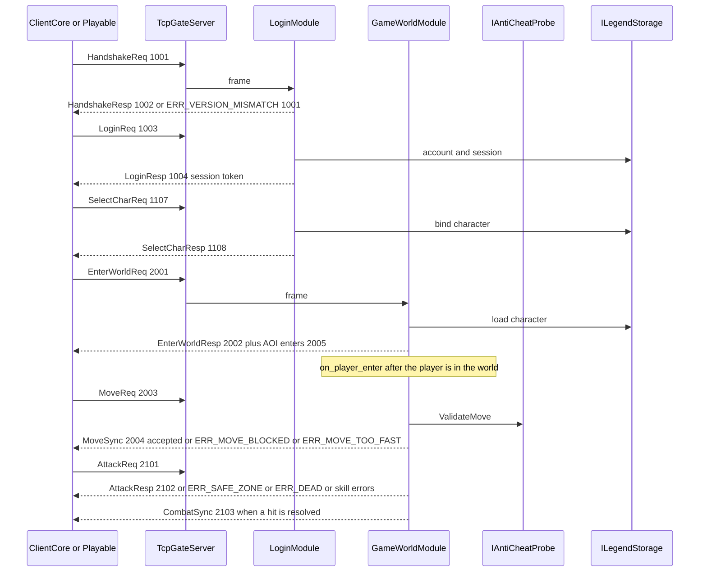

# 层契约（E0）

端口与数据流。架构背景与里程碑在 [ENGINE_REFACTOR_PLAN.md](ENGINE_REFACTOR_PLAN.md)。报文以 `protocol/legend_protocol.proto` 为准，MsgId 以 `Legend.Contracts.MsgId` 为准。

## 1. 已有端口

这些接口在 E0 之前就存在。E0 不改签名。

| 接口 | 程序集 | 职责 |
|------|--------|------|
| `IGameModule` | Legend.Contracts | 一个逻辑模块：`CanHandle(MsgId)`、`HandlePacketAsync`、断线清理。今天的实现是 `LoginModule` 与 `GameWorldModule`。 |
| `IClientSession` | Legend.Contracts | 一条连接上的账号、会话令牌、角色与 `SendAsync(MsgId, seq, message)`。Gate 持有实现。逻辑层不碰套接字。 |
| `IEventBus` | Legend.Contracts | 进程内领域事件。脚本主机订阅，世界在状态改变后发布。 |
| `IPlugin` | Legend.Contracts | 可开关插件。Host 启用内置审计插件。 |
| `IAntiCheatProbe` | Legend.Contracts | `ValidateMove`。默认实现 `DefaultAntiCheatProbe` 限制切比雪夫步长。世界在采纳移动前调用。 |
| `IVersionPackLoader` | Legend.Contracts | `LoadFromManifest`。实现是 `VersionPackLoader`。Host 启动与 `reload-pack` 都走它。 |
| `IPaymentProvider` / `IMerchantPaymentProvider` | Legend.Contracts | 支付沙箱。与 E0 无关，签名保持。 |
| `ILegendStorage` 及 `IAccountStore`、`ICharacterStore`、`ISessionStore` 等 | Legend.Storage | 持久化端口。E2 再上移到 Contracts。E0 不搬。 |
| `LegendSessionFsm` | Legend.ClientCore | 客户端会话阶段：断开、连接、登录、选角、进世界。不是服务端端口。网络 IO 在 Playable / Unity。 |

组合根是 `LegendServerEngine`。它创建加载器、存储、脚本、登录、世界和 Gate，不把具体类型泄漏给对端。

层引用的机器可读表是 `EngineLayerRules.AllowedProjectReferences`。扫描器是 `LayerReferenceScanner.FindViolations`。规则说明见重构计划第 4 节。

## 2. E0 新增端口

### `IConfigSchemaValidator`

程序集：`Legend.Contracts`。实现：`Legend.Core.ConfigSchemaValidator`。

```csharp
void Validate(string schemaId, string json, string sourceName);
```

- `schemaId` 使用 `ConfigSchemaIds`：`map`、`items`，以及 E1 的 `skills`、`monsters`、`lootTables`、`npcs`、`shops`、`quests`、`levels`、`guild`、`trade`。
- `json` 是文件原文。允许与加载器相同的注释和尾逗号。
- `sourceName` 写进错误信息，一般是相对路径。
- 成功则返回。失败抛 `ConfigSchemaException`（独立异常；`InvalidDataException` 不可继承）。现有热更 `catch (Exception)` 会回滚。
- `Errors` 列出实例路径和原因，最多 32 条。

`VersionPackLoader` 在反序列化每张地图和物品文件之前调用它。未登记的 `schemaId` 也是失败，避免调用方写错名字却当成功。

结构关键字由 `JsonSchemaSubsetEvaluator` 执行。同文件不变量由 `ConfigSemanticRules` 执行。两者都在 `Validate` 内，调用方不需要第二步。

### 启动失败

`LegendServerEngine.CreateAsync` 在 `StorageFactory.CreateAsync` 之前执行一次 `LoadFromManifest`。坏地图或坏物品不会先打开 Sqlite / Postgres。`Legend.Host` 的入口捕获 `ConfigSchemaException`、`InvalidDataException`、`FileNotFoundException`，写一条 `StructuredLogger` 错误后以退出码 1 结束。

热更路径不退出进程。`ReloadVersionPackAsync` 已有的失败回滚保持不变。

## 3. 错误码目录

玩家可见错误的唯一目录是 `protocol/legend_protocol.proto` 的 `enum ProtocolErrorCode`。生成后的 C# 枚举是 `Legend.Contracts.Proto.ProtocolErrorCode`。不要在 C# 里另建一套平行数字。

阅读方式：

| 范围 | 用途 | 例子 |
|------|------|------|
| `0` | 成功 | `ERR_NONE` |
| `1001–1011` | 握手、登录、角色 | `ERR_VERSION_MISMATCH`、`ERR_AUTH_FAILED`、`ERR_INVALID_TOKEN` |
| `1005`、`1006`、`1073` | 移动与速率 | `ERR_MOVE_BLOCKED`、`ERR_RATE_LIMITED`、`ERR_MOVE_TOO_FAST` |
| `1012–1018`、`1015` | 战斗 | `ERR_INVALID_SKILL`、`ERR_SKILL_COOLDOWN`、`ERR_SAFE_ZONE`、`ERR_DEAD` |
| `1019–1083` | 各玩法域拒绝 | 商店、任务、装备、行会、副本、支付等。名字即域 |
| `1999` | 未分类的服务端失败 | `ERR_INTERNAL` |

新增码追加到 1083 之后、1999 之前，并在 `PROTOCOL_NOTES.md` 记一笔。E0 不新增。

配置与脚本错误不进这个枚举。它们是进程日志和 Admin HTTP 文本。

## 4. 数据流：登录 → 进世界 → 移动 → 战斗

服务端裁决。下面的 MsgId 都已存在。客户端可以在收到拒绝前做表现，坐标与伤害以应答为准。



步骤说明：

1. **帧。** Gate 按 `PacketFrame` 拆包，按 `IGameModule.CanHandle` 交给登录或世界。逻辑层看到的是 `IClientSession` 与 payload，不是 TCP。
2. **握手与登录。** `LoginModule` 比较协议版本。失败码 `ERR_VERSION_MISMATCH (1001)`。登录成功后会话令牌写入 `ISessionStore`。之后的角色报文带这个令牌，失效为 `ERR_INVALID_TOKEN (1003)`。
3. **选角。** 1101–1108。职业 id 必须在版本包职业表里，否则 `ERR_INVALID_CLASS (1009)`。
4. **进世界。** `EnterWorldReq (2001)`。世界核对令牌和角色，把实体放进默认地图或角色所在地图，套用阻挡缓存与安全区，向视野内连接发 `EntityEnterAoi (2005)`，应答 `EnterWorldResp (2002)`。进入之后事件总线发布进世界事件，脚本钩子 `on_player_enter` 运行。钩子异常只记日志，不撤掉已经进世界的角色（18）。
5. **移动。** `MoveReq (2003)` 携带目标格。世界依次检查：已进世界、未死亡、地图可走（城门未破时城门格拒绝）、`IAntiCheatProbe.ValidateMove`、移动间隔。拒绝时 `MoveSync (2004)` 的 `Accepted` 为 false，`ErrorCode` 为 `ERR_MOVE_BLOCKED (1005)` 或 `ERR_MOVE_TOO_FAST (1073)`，坐标留在原格。接受后更新 AOI，并给离开视野的连接发 `EntityLeaveAoi (2006)`。传送门命中时另发 `MapChangeNotify (2007)`。
6. **战斗。** `AttackReq (2101)`。世界检查令牌、死亡、安全区、技能 id、距离、冷却、目标。安全区是 `ERR_SAFE_ZONE (1015)`，死亡是 `ERR_DEAD (1018)`。命中后写 `CombatSync (2103)`。击杀、掉落、拾取走 2104–2109，与本切片相邻，但 E0 不改它们的代码。

客户端：`LegendSessionFsm` 只记录阶段。Playable 的网络层把上述报文翻译成阶段切换和格子坐标。斜 45° 投影在 `IsoProjection`，不进入协议。预测端口留给 E5。今天被拒绝的移动以 `MoveSync` 为准。

## 5. E0 故意不做的端口

| 预期端口 | 里程碑 | 原因 |
|----------|--------|------|
| 存储端口搬到 Contracts | E2 | 现在搬会让本 PR 变成存储重构 |
| `IMovementRules` | E3 | 需要先有测试锁住现有拒绝码 |
| `ICombatResolver` | E4 | 同上，且不能改伤害数字 |
| ClientCore 预测端口 | E5 | 视觉原型未要求本 PR 改 Avalonia |
| 协议目录生成器 | E6 | E0 只给阅读指针 |
| 新的 `legend_api` 方法 | E7 之后 | 18 的扩展路线，不是地基 |

新 MsgId 在真正加报文之前保持 TBD。
