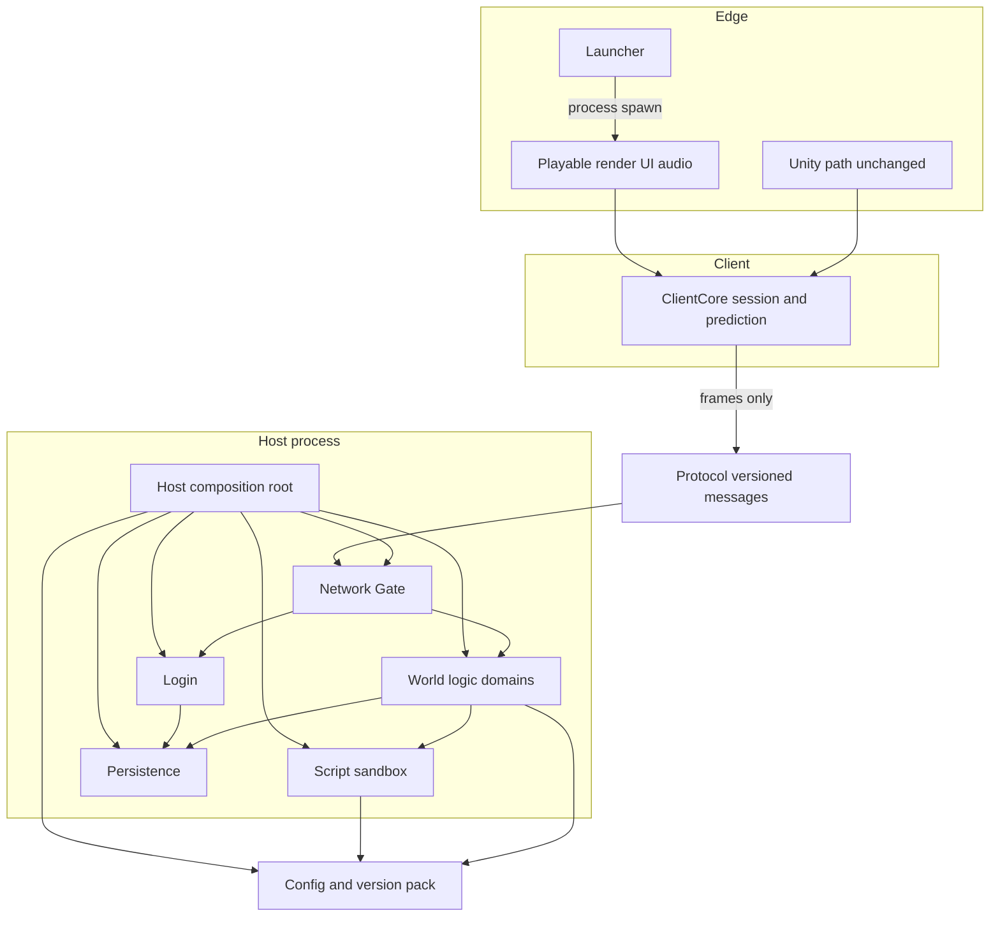

# 引擎重构计划（E0–E8）

Engine refactor plan for Open Legend Platform. This document is the architecture source for the refactor series. Feature completion stays in [MIR_PRODUCTION_FEATURE_MATRIX.md](MIR_PRODUCTION_FEATURE_MATRIX.md). Domain specs stay in `docs/site/00-overview.md` through `docs/site/22-security-anti-cheat.md`. Protocol additions stay in [PROTOCOL_NOTES.md](PROTOCOL_NOTES.md). Writing rules stay in `docs/site/conventions.md`.

E0 does not change the matrix score. `MATRIX_COMPLETE` stays true. DocOnly extensions (multi-currency, zodiac, hero combo, client assist, talents, and the rest of the site extension lists) are not implemented here.

## 1. 目的

把已经跑通的矩阵路径收成稳定的层边界，让后续每个玩法增量都落在一个小 PR 里。服务端继续裁决。客户端只做呈现和有限预测。协议保持版本化。配置在加载期失败，而不是进世界后空引用。

本系列不追求兼容 996、Crystal、GOM 或任何闭源引擎的报文、脚本命令或资源格式。MsgId 未落地的能力继续写 **TBD**，不预占数字。

## 2. 现状（对照 site 00–22）

| 层 | 今天的代码 | 规格落点 |
|----|------------|----------|
| Host | `server/Legend.Host`：`LegendServerEngine` 组装进程，Admin HTTP | 00、21 |
| Network | `server/Legend.Gate/TcpGateServer` | 00、22 |
| Protocol | `protocol/legend_protocol.proto`，`Legend.Contracts.MsgId`，`ProtocolConstants`（1.21.0） | 00、conventions、PROTOCOL_NOTES |
| Login | `server/Legend.Login/LoginModule` | 01、02 |
| World / Logic | `server/Legend.Game/GameWorldModule` 及其 partial（移动、战斗、经济、行会、攻城、副本、外观、宠物、支付） | 03–17 |
| Persistence | `server/Legend.Storage`（InMemory / Sqlite / Postgres，Redis 会话）。端口 `ILegendStorage` 与记录类型在 `Legend.Contracts` 程序集，命名空间仍是 `Legend.Storage` | 17、21 |
| Config / Script | `Legend.Core.VersionPackLoader`，`version-packs/*`，`Legend.Script.LuaScriptHost`（`legend_api`） | 18 |
| ClientCore | `client/Legend.ClientCore`：会话状态机、背包视图模型，无 Unity / Avalonia | 19 |
| Playable | `client/Legend.Playable`：Avalonia 渲染、UI、程序音效、网络收发 | 19、20 |
| Launcher | `launcher/`：选区、延迟、更新清单、拉起客户端。独立解决方案，不进游戏协议 | 01 |
| Unity | `client/unity-mvp`、`client/unity-sdk`。本系列不改 | UNITY_CLIENT_MVP |

已知耦合（E0 只登记，不搬文件）：

- `Legend.Game` 与 `Legend.Login` 只引用端口所在的 `Legend.Contracts`。存储实现仍由 Host 注入。
- `GameWorldModule` 按 partial 切文件，类型仍是一个模块，战斗和移动没有独立端口。
- `Legend.Playable` 引用 `Legend.Contracts` 以编解码报文。这是允许的。它不引用 Game / Host / Storage。
- 配置校验主要是反序列化后的空 id 与少量交叉引用。`tools/Legend.MapValidate` 另做地图语义检查，Host 启动不调用它。
- 热重载 `POST /admin/reload-pack` 走同一 `LoadFromManifest`。加载失败会回滚（18）。

## 3. 目标架构



文本依赖（箭头表示“可以引用”）：

```
Launcher        -> Launcher.Core
Playable        -> ClientCore, Protocol/Contracts
ClientCore      -> (none)
Unity           -> 不在本系列改动范围
Host            -> Gate, Login, World, Script, Persistence, Core, Contracts
Gate            -> Core, Contracts
Login           -> Core, Contracts, Persistence ports
World           -> Core, Contracts, Persistence ports
Script          -> Core, Contracts
Persistence     -> Contracts
Core            -> Contracts
Contracts       -> (none; protobuf generated from protocol/)
```

## 4. 依赖规则

允许：

- 上层指向内层。Host 是组合根，可以引用所有服务端项目。
- 任何游戏逻辑可以引用 `Legend.Contracts` 的报文、错误码、纯规则和端口。
- Playable 可以引用 Contracts 来读写帧。不可以引用 Game、Host、Storage、Script、Gate、Login、Core。
- 登录器只引用 `Legend.Launcher.Core`。不引用服务端。

禁止：

- Contracts 引用任何业务项目。
- Core 引用 Game、Storage、Gate、Script、Host、Login。
- Storage 引用 Core 或 Game（日志与加载留在 Core；存储不知道世界）。
- Game 与 Login 引用 Host、Gate、Script、Login，以及 `Legend.Storage` 实现项目。脚本由 Host 订阅事件总线，世界不调用 Lua 主机。
- Script 引用 Game。钩子参数保持标量与 id，不传入实体对象。
- 客户端引用服务端世界或存储。

E0 用 `EngineLayerRules`（Contracts）和 `LayerReferenceScanner`（Core）锁住上表。E2 起 `Legend.Game` / `Legend.Login` 不再引用 `Legend.Storage` 实现项目。测试项目与 `tools/` 里除已点名者外不进这张表。

已点名、允许的工具边：

| 项目 | 允许的项目引用 |
|------|----------------|
| `Legend.CliClient` | Contracts, Storage |
| `Legend.MapValidate` | Contracts, Core |
| `Legend.Merge` | Storage |

## 5. 协议版本与错误码

事实来源：

- 版本字符串：`protocol/VERSION` 与 `ProtocolConstants.CurrentVersion`，当前 **1.21.0**。`MinCompatibleVersion` 同为 1.21.0。
- 帧：大端 `[Len:4][MsgId:2][Seq:4][Payload]`，`HeaderSize = 10`，Payload 最大 1MB。
- MsgId：`server/Legend.Contracts/ProtocolConstants.cs` 的 `MsgId`。没有的报文写 TBD，不编造数字。
- 字段：`protocol/legend_protocol.proto`。
- 错误码：同一 proto 文件的 `ProtocolErrorCode`。C# 名在生成代码 `Legend.Contracts.Proto.ProtocolErrorCode`。

策略：

- 号段沿用 00 总览的表。新 MsgId 追加到域的尾部，并写入 `PROTOCOL_NOTES.md`。
- 错误码只追加，不改已发布数值。`ERR_NONE = 0`。域错误目前在 1001–1083。`ERR_INTERNAL = 1999` 只表示服务端未分类失败，不把校验细节塞进这个码。
- 配置错误不是玩家报文。加载失败抛 `ConfigSchemaException`。`InvalidDataException` 在 .NET 里是密封类，所以这是独立异常。热更代码捕获 `Exception` 后回滚。Host 入口按类型捕获后退出。客户端看不到它。
- 在验收脚本仍锁定 `1.21.0` 之前，不改 `protocol/VERSION`。升到下一版时同时改版本文件、`ProtocolConstants`、验收脚本和可玩客户端字面量。
- 兼容规则保持现有主次版本比较（`ProtocolConstants` 内）。E0 不改比较器。

错误码目录的阅读顺序见 [ENGINE_LAYER_CONTRACTS.md](ENGINE_LAYER_CONTRACTS.md)。

## 6. 配置 Schema 与热更边界

规格对照：`docs/site/18-script-config-hotreload.md`。

版本包根是 `version-packs/<pack>/manifest.json`。样例 `sample-classic` 是生产路径（协议字符串 1.21.0）。`sample-176` 是职业表示例，同样要能被加载器读过。

E0 起，地图 JSON 与 `configs/items.json` 在 `VersionPackLoader.LoadFromManifest` 里先过 JSON Schema 子集，再反序列化。Host 在打开数据库之前调用同一次加载。失败即抛，进程以非零退出。`reload-pack` 用同一加载器，失败保持上一份包（现有回滚）。

Schema 文件：

- `server/Legend.Core/Schemas/map.schema.json`
- `server/Legend.Core/Schemas/items.schema.json`

方言是 JSON Schema draft 2020-12 的一个显式子集。求值器遇到未实现关键字（例如 `$ref`、`allOf`、`if`）会在构造期失败，避免静默忽略。已实现：`type`、`properties`、`required`、`additionalProperties`（布尔）、`items`、`enum`、`pattern`、`minLength`、`maxLength`、`minimum`、`maximum`、`minItems`、`maxItems`。忽略：`$schema`、`$id`、`title`、`description`、`$comment`。

结构校验之外的同文档不变量放在 `ConfigSemanticRules`：出生点、阻挡、传送门、安全区必须落在宽高内；物品 id 与强化目标等级不重复；`kind=equipment` 必须有槽位；技能、怪物、掉落表、NPC、商店、任务 id 不重复；掉落 `countMax` 不小于 `countMin`。跨文件引用在 `VersionPackLoader.EnsureCrossReferences` 抛 `InvalidDataException`：刷怪怪物与地图、NPC 地图、任务 NPC、掉落物品 id、怪物掉落表、商店与任务奖励、任务目标怪物、技能书与职业。E1 已把技能、怪物、掉落、NPC、商店、任务、等级、行会、交易纳入同一校验器。Buff、攻城、邮件、副本、世界 Boss、坐骑、时装、宠物仍只做原有检查。

热更边界：

| 可以热更 | 不可以热更 |
|----------|------------|
| 版本包 JSON 与 Lua（整包替换，失败回滚） | 协议版本字符串、MsgId、帧格式 |
| 地图、物品，以及 E1 的技能、怪物、掉落、NPC、商店、任务、等级、行会、交易 | 正在结算的那一次请求混用新旧表 |
| 尚未纳入 Schema 的其余 `configs/*.json` | 客户端上传脚本或配置 |

`paperdoll` 出现在物品 JSON 里，给客户端纸娃娃用。服务端 POCO 不读取它。Schema 允许该字段，避免加载被客户端表现字段打断。地图 flag（`noHang`、`noAutoPickup` 等）是 DocOnly，样例地图没有这些键。E0 的地图 Schema 使用 `additionalProperties: false`，未知键会拒绝加载。等对应里程碑把 flag 写进规格和 Schema 后再出现在包里。

## 7. 里程碑

每个里程碑一个 PR。先保住矩阵已 Done 的路径，再排 DocOnly。退出标准都包含：相关测试通过、`protocol/VERSION` 仍是 1.21.0（除非该里程碑的说明明确要求升版）、不把扩展路线写成矩阵 Done。

### E0 — 地基（本 PR）

范围：本文、层契约、地图与物品 Schema、启动失败即停、层引用守卫、文档交叉链接。

退出：

- `dotnet build server/LegendPlatform.sln -c Release`
- `dotnet test server/Legend.Tests/Legend.Tests.csproj -c Release --filter "FullyQualifiedName~ConfigSchema|FullyQualifiedName~LayerReference"`
- `./scripts/build-docs-site.sh` 与改前相比无新的 docfx 错误

风险：Schema 比旧加载器更严，手写地图若带未知字段会起不来。样例包已对齐。

### E1 — 生产配置 Schema 补齐（已完成）

状态：已合入实现。`sample-classic` 的 `item_slime_gel` 与 `item_boar_hide` 补进 `items.json`，因为掉落表已经引用它们，否则整包无法在新的交叉引用下加载。出售这两件物品时，未知物品从拒绝变为按 `SellUnitPrice` 计价（无商店报价时为 1）。不改战斗公式，不新增 MsgId。

范围：技能、怪物与刷怪、掉落、NPC、商店、任务、等级、行会、交易这些 `manifest` 已指向的文件。交叉引用（刷怪怪物 id、NPC 地图、任务 NPC、掉落物品 id）在加载期失败。`Legend.MapValidate` 改为调用同一校验器，避免两套规则。

不改玩法，不新增 MsgId。

退出：`sample-classic` 整包加载通过；故意写错的掉落 id 使 `LoadFromManifest` 抛 `ConfigSchemaException` 或现有 `InvalidDataException`；`reload-pack` 错误路径仍回滚（`scripts/verify-m19.sh` 或等价的加载器测试）。

风险：历史包里的可选字段被 `additionalProperties: false` 拒绝。先用样例包扫字段再收紧。

测试：`dotnet test server/Legend.Tests/Legend.Tests.csproj -c Release --filter "FullyQualifiedName~ConfigSchema"`，外加一条加载器交叉引用测试。

### E2 — 持久化端口上移（已完成）

状态：已完成。`ILegendStorage`、各存储端口，以及它们签名里的记录类型和 JSON 辅助类型编进 `Legend.Contracts`。命名空间仍是 `Legend.Storage`，方法签名未改。实现留在 `Legend.Storage`。Game / Login 不再引用该实现项目。没有 SQL 变更。

范围：把 `ILegendStorage` 及账户、角色、会话、行会、交易、邮件、支付等存储端口从 `Legend.Storage` 挪到 `Legend.Contracts`（或一个只含端口的新项目，由 Contracts 再导出）。实现留在 Storage。Game / Login 的项目引用改为只依赖端口所在项目。行为不变，不写新迁移。

若移动端口时发现必须改 SQL，该迁移必须可回滚，并单独说明。E2 的默认是零 SQL。

退出：层引用测试更新为 Game 不再引用 Storage 实现项目；现有存储测试仍通过。

风险：接口搬家造成大 diff。只搬类型，不改方法签名。

测试：`dotnet test server/Legend.Tests/Legend.Tests.csproj -c Release --filter "FullyQualifiedName~LayerReference|FullyQualifiedName~M1"`。M1 覆盖登录与进世界所依赖的存储。

### E3 — 世界切片：进图与移动（已完成）

状态：已完成纯判定抽取。`IMovementRules` / `DefaultMovementRules` 决定阻挡、城门、步长探针、骑乘移速、进世界落点和传送门。安全区标记仍由 `GridAoiManager` 写入，但改调同一规则。AOI 进出视野没有改。报文仍是 2001–2007。

范围：从 `GameWorldModule` 抽出进世界与移动的纯判定（阻挡、传送、安全区标记、`IAntiCheatProbe.ValidateMove`、移速），放到同程序集的小类型，例如 `IMovementRules`。报文仍是 2001–2007。`GameWorldModule` 变薄，仍是 `IGameModule`。

不拆进程，不改 AOI 行为。

退出：移动拒绝仍返回 `ERR_MOVE_BLOCKED (1005)` 与 `ERR_MOVE_TOO_FAST (1073)`。现有 M2 / playable 相关测试不回退。

风险：partial 之间的私有状态被抽走后生命周期错误。先抽纯函数，再抽带状态的 AOI。

测试：`dotnet test server/Legend.Tests/Legend.Tests.csproj -c Release --filter "FullyQualifiedName~M2|FullyQualifiedName~Movement"`。

### E4 — 战斗切片与反作弊钩子（已完成）

状态：已完成。`ICombatResolver` / `DefaultCombatResolver` 承接攻击门闩（死亡、安全区、技能、冷却探针、MP）、距离、Buff 施加判定，以及伤害数字转发。`IAntiCheatProbe.ValidateAttackInterval` 默认与原冷却检查一致，可被测试替换。错误码仍用 1012–1016、1018、1051、1073。伤害公式未改。

范围：攻击、技能、Buff 的结算入口收成 `ICombatResolver`（名字可在实现时按现有 `CombatMath` 调整）。`IAntiCheatProbe` 继续负责步长；为攻击间隔补一个同风格的探针方法，默认行为与今天的冷却检查一致。错误码仍用 1012–1016、1018、1051、1073。

不新增技能，不改伤害公式。

退出：安全区攻击仍是 `ERR_SAFE_ZONE (1015)`。探针可被测试替换。

风险：把公式搬家时四舍五入不一致。用现有战斗测试锁数字。

测试：`dotnet test server/Legend.Tests/Legend.Tests.csproj -c Release --filter "FullyQualifiedName~M3|FullyQualifiedName~M4|FullyQualifiedName~Combat"`。

### E5 — 客户端预测边界（已完成）

范围：在 `Legend.ClientCore` 增加窄端口，例如移动预测的“申请 / 被服务器拒绝则回滚”。`Legend.Playable` 改为调用该端口。预测失败时以 `MoveSync.Accepted = false` 为准回到服务器坐标。不改 Avalonia 布局，不改 Unity。

退出：ClientCore 单测覆盖接受与拒绝回滚。Playable 仍引用 Contracts，仍不引用 Game。

风险：预测与斜 45° 点击换算不一致。预测只存格子坐标，投影留在 Playable。

测试：`dotnet test client/Legend.Playable.Tests/Legend.Playable.Tests.csproj -c Release` 与 ClientCore 相关的服务端测试过滤器（今天 ClientCore 测试在 `Legend.Tests` 的 Phase F/G）。

### E6 — 协议目录守卫（已完成）

范围：测试锁定 `MsgId` 与 proto 消息的对应关系、`ProtocolErrorCode` 数值不重复且不回收。可以生成一份只读目录到 `docs/`，或只在测试里断言。不新增报文，不升 `protocol/VERSION`。

退出：故意改一个枚举数值时测试失败。`PROTOCOL_NOTES.md` 的“仍缺”列表保持 TBD。

风险：生成代码路径在不同机器上不一致。测试读 `legend_protocol.proto` 源文件，不读生成结果里的注释。

测试：`dotnet test server/Legend.Tests/Legend.Tests.csproj -c Release --filter "FullyQualifiedName~ProtocolCatalog"`。

### E7 — 热更与脚本边界收紧（已完成）

范围：把“坏配置回滚、Lua 异常不打崩移动循环、沙箱没有 IO”收成一组聚焦测试。不增加 `legend_api` 方法，不做定时脚本。若 E1 已覆盖回滚，本里程碑只补脚本侧缺口。

退出：`scripts/verify-m19.sh` 通过。新测试证明钩子抛错后 Host 对象仍可处理移动。

风险：测试用的脚本文件污染样例包。放在测试临时目录。

测试：`dotnet test server/Legend.Tests/Legend.Tests.csproj -c Release --filter "FullyQualifiedName~M19|FullyQualifiedName~ScriptSandbox"`，以及 `scripts/verify-m19.sh`。

### E8 — 第一个 DocOnly 切片：地图 flag

范围：只做 `docs/site/04-map-movement.md` 已写明的地图布尔 flag 中的加载与服务端拒绝。建议先 `noPk`（安全区之外的禁 PK）或规格里已经点名、且不需要新 MsgId 的那一个。Schema 在 E1 的地图规则上增加可选布尔，默认 false。样例地图不改行为。

明确不做：内挂状态机、多货币钱包、英雄、合击、天赋、生肖、商城。

退出：flag 为 true 的临时地图拒绝对应操作并返回已有错误码（不新造 MsgId，除非规格要求且同时升版）。flag 缺省时与今天一致。

风险：把 DocOnly 误计进矩阵。本里程碑不改矩阵分数。

测试：加载器测试加一条 flag 地图；一条世界测试证明缺省地图行为不变。

### E8 之后（不在本系列的实施范围，只排期）

下一张 PR 从这里挑一项，仍是一项一 PR：

| 顺序 | 能力 | 规格 | 备注 |
|------|------|------|------|
| E9 | 多货币账本与回收日限 | 11、12 | 运行时钱包。样例仍可只启用 `gold` |
| E10 | 天赋 / 内功配置加载 | 03 | 先 Schema 与存档字段，不做法术 |
| E11 | 生肖容器与神器槽 | 07、16 | 装备位扩展 |
| E12 | 英雄与合击 | 05、15 | 要新报文时先改规格，MsgId 在实现前保持 TBD |
| E13 | 客户端内挂 | 19、06、22 | 只发已有移动、攻击、拾取、使用物品报文。默认关。服务端速率与地图禁挂以 E4、E8 为准 |

## 8. 矩阵路径与 DocOnly

MVP 是矩阵里已经 Done 的登录、进世界、移动、战斗、物品、任务、行会、交易等路径。重构只改变这些路径的内部边界，不改变玩家可见结果。

下列能力在 site 各篇扩展路线和术语表里，**没有**矩阵叶子。它们不进入 E0，也不进入 E1–E7：

多货币、生肖、神器槽、英雄、合击、内功、天赋、内挂、拾取过滤、三职业自动、自动施毒、保护吃药、离线挂机、翅膀与限时时装、坐骑状态机、宠物蛋、地图 flag（E8 才开始）、拍卖行、跨服。

完成度仍然只由矩阵计算。扩展做完并要计分时，先改矩阵，再改文档（conventions）。

## 9. 本 PR 的非目标

- 战斗、商城、英雄、内挂、全玩法的实现或重写
- Unity 客户端
- Avalonia 视觉重做
- 新 MsgId、新错误码、协议版本号
- 数据库迁移
- 把 `GameWorldModule` 拆成多个项目
